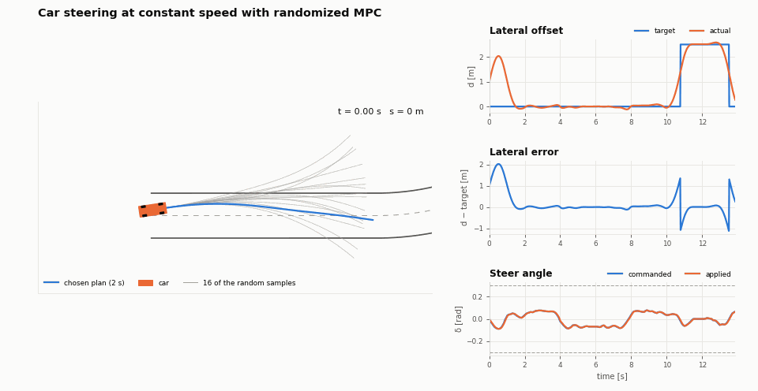
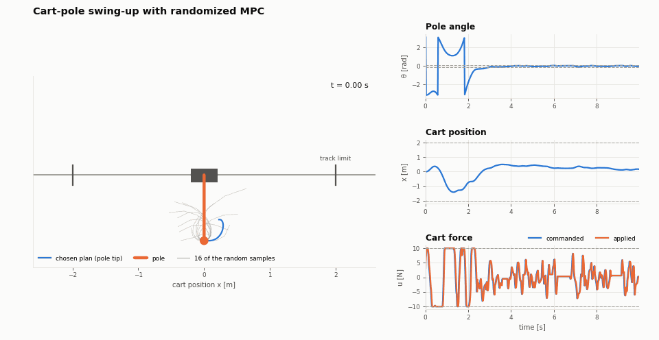
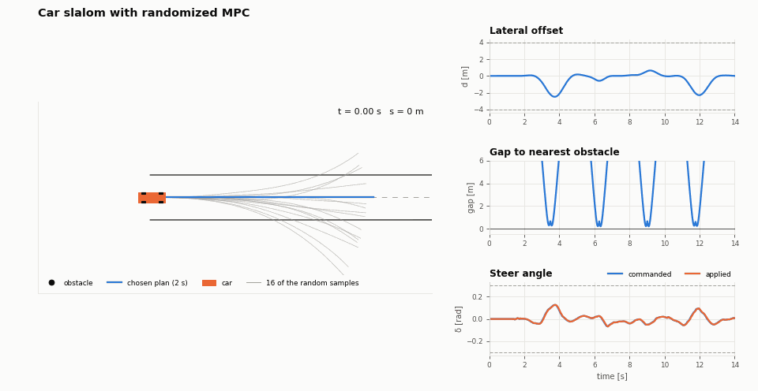
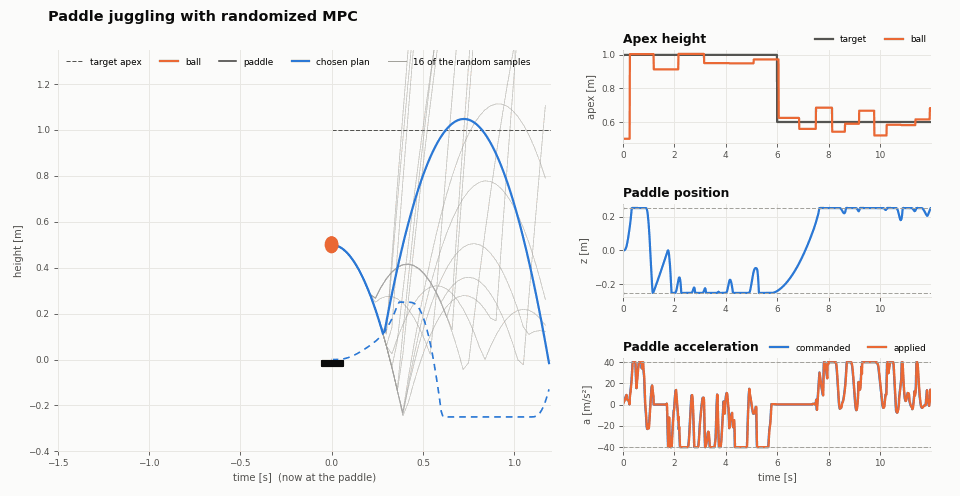

# rmpc: randomized MPC on the GPU

`rmpc` is a small, header-only CUDA library for **randomized model predictive
control** of any single-input system. Each control step it draws thousands
of input sequences that respect your input bounds and rate limit, simulates
all of them in parallel on the GPU through your model, and applies the
cheapest one.

**Your model and cost do not have to be continuous or differentiable.**
The controller only ever *evaluates* them, so impacts, switches,
saturations, lookup tables, `if`/`else` logic and on/off penalties are all
fine. This is what sets it apart from gradient-based MPC.

The method was developed for autonomous driving and is now a general tool:
you describe your problem with one struct (state, model step, cost) and the
engine does the rest. **You are warmly encouraged to use it for your own
systems.** The four examples below range from a racing car to a juggling
paddle, and none of them needed a change to the engine.

| Car steering at constant speed | Cart-pole swing-up |
|---|---|
|  |  |
| **Car slalom: flat collision cost, pass on either side** | **Paddle juggling: impacts, zero-gradient cost** |
|  |  |

In every animation, blue is the plan the controller chose, orange is what
the plant did, and the grey lines are some of the random samples it
rejected. Every frame comes from the same `step` function the controller
rolls out on the GPU.

## Why no continuity is needed

Gradient-based MPC (for example a nonlinear program solved with SQP or an
interior-point method) improves a plan by following derivatives of the
model and cost. That quietly requires both to be smooth: a jump, a flat
region or a branch either breaks the solver or gives it nothing to follow,
and with several separate good solutions it stays with whichever one its
initial guess was nearest.

`rmpc` never takes a derivative. It proposes many complete plans, simulates
them, and compares their costs. All it needs from your problem is that
`step` and the cost can be **computed**. That allows, for example:

- **discontinuous dynamics:** impacts and bounces, contact and friction
  switching, mode changes, dead zones, backlash, saturations, gear changes;
- **non-smooth or flat costs:** "collision or not", counts, thresholds,
  `min`/`max`, penalties that only change at events;
- **nonconvex problems with several good answers:** pass an obstacle on the
  left or the right, swing a pendulum up in either direction;
- **any code you can run on the GPU:** branches, loops, table look-ups,
  your own integrator.

Two examples are built around exactly this: the car slalom (a flat "hit or
not" collision cost, and two ways around every obstacle) and paddle
juggling (a jump in velocity at every bounce, and a cost that only changes
at a bounce). See [Where sampling beats gradients](#where-sampling-beats-gradients).

The *input* sequences, on the other hand, are smooth on purpose: they are
built from a few cosine modes so that the commands are kind to real
actuators and always respect the bounds and rate limit. Smoothness is a
property of the commands the controller sends, not a requirement on your
model.

## Is it a good fit for your problem?

**Good fit:**

- one control input (a steer angle, a force, a torque, a valve, a
  voltage, an acceleration);
- dynamics fast enough to need a decision every few to tens of
  milliseconds;
- a model or cost that is non-smooth, hybrid or nonconvex, or simply
  awkward to differentiate;
- hard limits on the input and its rate.

**Less suited:**

- several inputs at once (the engine is single-input today);
- very long horizons on unstable systems: random open-loop plans all
  diverge, so keep the horizon short (the cart-pole uses 0.8 s);
- problems that are smooth and convex, where a gradient-based solver will
  usually find a more precise optimum;
- hard *state* constraints: express them as costs (the examples show how).

## How it works

On every solve, for `n_samples` candidates in parallel:

1. **Sample.** Draw a few random coefficients of cosine modes (an inverse
   DCT) to get a smooth sequence of input increments. Sum them from the
   current input, clamping every increment to the rate limit and every
   input to the bounds. Every candidate is therefore feasible. One candidate
   holds the current input, and with warm start another one continues the
   previous plan.
2. **Roll out.** Simulate the candidate over the horizon with your `step`
   function (one GPU thread per candidate), with an optional first-order
   actuator lag.
3. **Score.** Add up your `stageCost` and `terminalCost`.
4. **Select.** Return the cheapest candidate; apply its next input.

The car example (5000 samples × 100 steps) solves in about **0.8 ms**
(median, NVIDIA RTX A2000 Laptop GPU).

## Defining a problem

```cpp
#include "rmpc/rmpc.cuh"

struct Integrator {                       // x' = u, reach a target
  struct State     { float x; };
  struct Params    { float q, r; };
  struct Reference { float target; };     // one per horizon step

  RMPC_HD static State step(const State& s, float u, const Reference&,
                            const Params&, float dt) {
    return {s.x + dt * u};
  }
  RMPC_HD static float stageCost(const State& s, float u, float u_prev,
                                 const Reference& ref, const Params& p,
                                 int k, int n) {
    return p.q * (s.x - ref.target) * (s.x - ref.target) + p.r * u * u;
  }
  RMPC_HD static float terminalCost(const State& s, const Reference& ref,
                                    const Params& p, int n) {
    return p.q * (s.x - ref.target) * (s.x - ref.target);
  }
};

rmpc::Config cfg;                         // horizon, samples, bounds, rate...
cfg.u_min = -0.5f; cfg.u_max = 0.5f; cfg.du_max = 2.0f;
auto ctrl = rmpc::Controller<Integrator>::create(cfg, {1.0f, 0.01f});
auto sol  = ctrl.value()->solve(x, u, refs);    // refs: n_horizon references
u = sol.value().nextInput();
```

`RMPC_HD` functions compile for both the GPU and the CPU, so the same model
also drives your simulation, tests, and plots.
**[docs/writing_a_problem.md](docs/writing_a_problem.md)** covers the full
interface, timing convention, sampling, tuning tips, and how to turn a
problem into a new example with its own animation.

### Use it for your own system

1. Copy an example folder (the cart-pole is the smallest complete one).
2. Write your `State`, `step` and costs in `problem.cuh`.
3. Set the input bounds, rate limit, horizon and weights in `config.yaml`.
4. Run the closed loop and watch it with `animate.py`.

If you apply it to a new kind of system, please share it: a pull request
with a new example under `examples/`, or an issue describing what worked
and what did not, helps the next person. And if it ends up in your
research, please [cite it](#citing).

## Examples

| Example | System | Shows |
|---|---|---|
| [`examples/car_steering`](examples/car_steering) | Dynamic single-track car with Pacejka tires and aero downforce, in Frenet coordinates, at constant speed. Input: steer angle. | Path following through an S-curve and a lane change, with soft track-bound, tire-grip and slip-angle limits |
| [`examples/cartpole`](examples/cartpole) | Cart-pole (rigid rod, RK4). Input: cart force. | Swing-up from hanging and balance: underactuated and nonconvex |
| [`examples/car_obstacles`](examples/car_obstacles) | The car above, reused unchanged, plus obstacles on the road. | A slalom where each obstacle can be passed on either side, with a flat "hit or not" collision cost |
| [`examples/paddle_juggling`](examples/paddle_juggling) | A ball bouncing on a paddle (1-D). Input: paddle acceleration. | Hybrid dynamics with impacts; the cost on the ball's energy only changes at a bounce |

### Where sampling beats gradients

The last two examples are built to be hard for gradient-based MPC (for
example an NLP solver behind a nonlinear MPC formulation):

- **Car slalom.** The collision cost is a constant penalty while touching
  an obstacle and zero otherwise, so its gradient is zero wherever it is
  defined; and every obstacle splits the solutions into "left" and
  "right", so a local solver keeps whichever side its initial guess was
  on. The random samples cover both sides on every solve.
- **Paddle juggling.** A bounce is a jump in the ball's velocity, and the
  cost is on the ball's energy, which only changes at a bounce. Between
  bounces the cost does not depend on the input at all, so there is no
  gradient to follow. Sampling only needs to evaluate the cost.

Neither example needed a change to the engine: the slalom wraps the car
problem and adds a cost term, and the bounce is a branch inside `step`.

Each example has a `problem.cuh` (the struct), a `config.yaml` (shared
`engine:` section plus problem parameters), a `closed_loop.cu` (simulation
that writes CSV logs) and an `animate.py`.

## Build and run

Requirements: an NVIDIA GPU, CUDA Toolkit 12.6+, CMake 3.27+, a C++20 host
compiler (GCC 13 tested), yaml-cpp and GoogleTest (examples and tests
only), and Python 3 with numpy, matplotlib and Pillow for the animations.
The dev container in [`.devcontainer/`](.devcontainer) has all of it; open
the folder in VS Code and choose **Dev Containers: Reopen in Container**
(this needs Docker and the NVIDIA Container Toolkit on the host).

```bash
cmake -S . -B build -DCMAKE_BUILD_TYPE=Release
cmake --build build -j$(nproc)
ctest --test-dir build --output-on-failure     # -LE slow skips the closed loops

python3 examples/cartpole/animate.py           # run the closed loop, play it
python3 examples/car_steering/animate.py --save car.gif
python3 examples/car_obstacles/animate.py
python3 examples/paddle_juggling/animate.py

./build/tests/timing/rmpc_timing               # per-solve latency report
```

`animate.py` runs the example's closed-loop binary first (pass `--no-run`
to replay existing logs from `logs/`), then shows a window or, with
`--save`, writes a GIF or MP4.

To use the engine in your own CMake project, link the header-only
`rmpc::rmpc` target and compile your problem code as CUDA (`.cu`).

## Citing

If you use this software in your research, please cite:

> A. Muraleedharan, H. Okuda, and T. Suzuki, "Real-Time Implementation of
> Randomized Model Predictive Control for Autonomous Driving," *IEEE
> Transactions on Intelligent Vehicles*, vol. 7, no. 1, 2022,
> doi: [10.1109/TIV.2021.3062730](https://doi.org/10.1109/TIV.2021.3062730).

GitHub's **Cite this repository** button gives the same entry from
[`CITATION.cff`](CITATION.cff), together with related work:
A. Muraleedharan, I. Simões, and G. Pau, "Randomized Model Predictive
Control for Autonomous Racing," *2025 IEEE Intelligent Vehicles Symposium
(IV)*.

### Background

The method comes from the author's PhD work on autonomous driving (the 2021
paper above). Later work extended it with longitudinal control and gear
shifting, a combined-slip tire model, and a neural-network speed correction
(the 2025 paper, and "Learning-Augmented Nonlinear MPC for Autonomous
Racing", ITSC 2026). This repository takes the core method out of the
vehicle setting and makes it a general controller for any single-input
problem: a clean problem interface and four worked examples. None of the
vehicle-specific extensions are included.

## License

**Free for non-commercial use; commercial use needs a license.**

This software is released under the
[PolyForm Noncommercial License 1.0.0](LICENSE.md). You may use, modify and
share it for any non-commercial purpose: research, teaching, study,
personal projects, and any use by universities, public research
organizations and other non-commercial institutions, regardless of how they
are funded. Using it in a commercial product or service, or selling it,
requires a separate commercial license: contact **marunmurali@gmail.com**.

Copyright (c) 2026 Arun Muraleedharan.

## Contributing

See [CONTRIBUTING.md](CONTRIBUTING.md) for code style, tests and the
review process.
